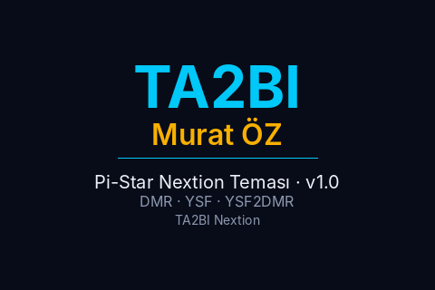
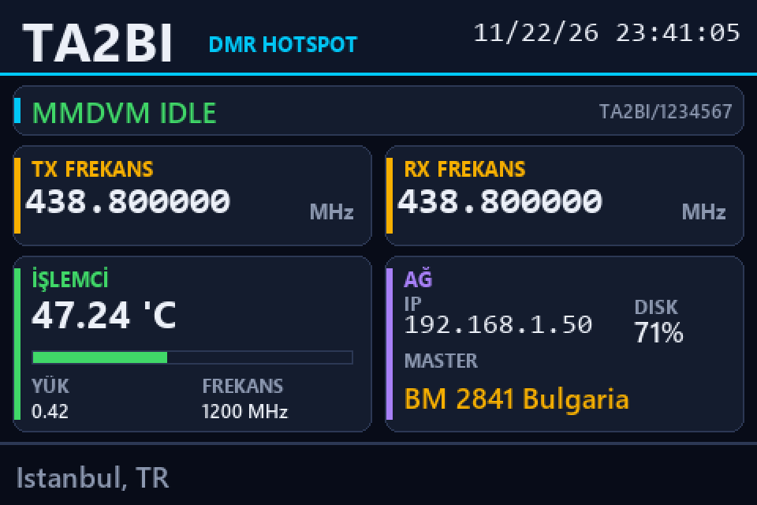
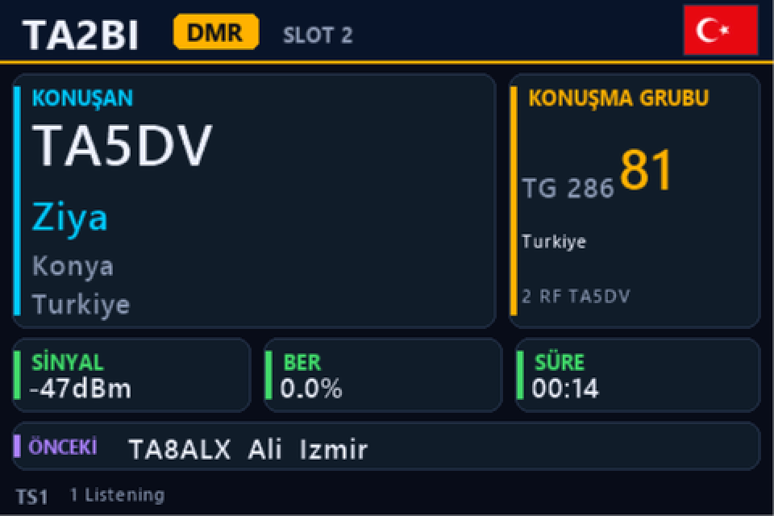
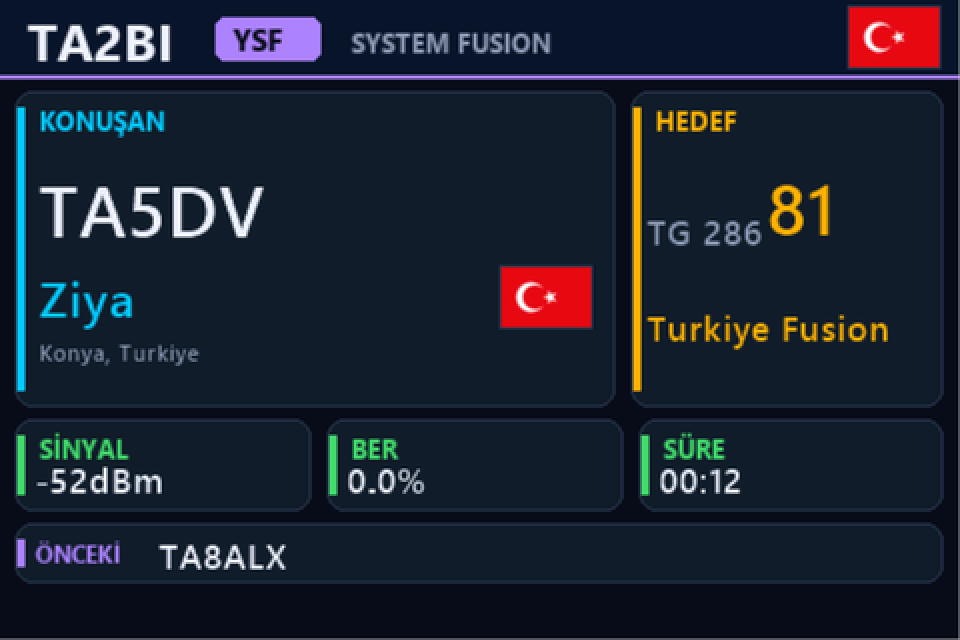
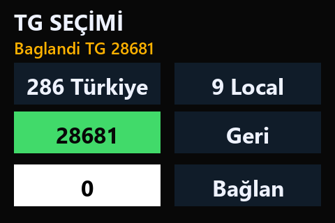
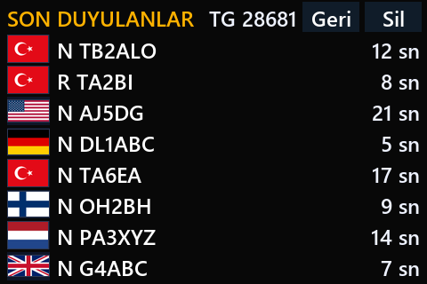

# TA2BI Nextion – Pi-Star Koyu Tema

**Nextion 3.5" (480×320)** ekranlar için Pi-Star / MMDVM hotspot teması.
**Basic NX4832T035** ve **Enhanced NX4832K035** modelleri desteklenir.
DMR, YSF ve YSF2DMR kullanımına göre hazırlandı.

Tasarım: **TA2BI – Murat ÖZ** · [English summary below](#english)

| Açılış | Ana ekran (MMDVM) |
|---|---|
|  |  |
| **DMR** | **YSF** |
|  |  |
| **TG seçme** (düğmeye basınca "Baglandi") | **Son duyulanlar** |
|  |  |

> Görseller tasarım önizlemesidir; örnek değerler içerir. TG seçme ve Son duyulanlar görselleri `tasarim/render_tg.py` ile HMI'daki gerçek konum, renk ve yazı tipinden çizilmiştir (ekran fotoğrafı değildir).

## Özellikler
- Koyu tema, büyük ve okunaklı alanlar, Türkçe etiketler.
- **Ana ekran:** saat, durum, TX/RX frekansı, CPU sıcaklığı/yükü/frekansı, IP, boş disk, bağlı master.
- **Büyük çağrı işareti ve iki parçalı TG:** ülke kodu küçük, devamı büyük yazılır. Örneğin `TG 286` küçük, **81** büyük.
- **DMR:** konuşanın çağrı işareti, adı, şehri ve ülkesi; **ülke bayrağı** sağ üstte (186 ülke); TG adı, slot, RSSI, BER ve süre.
- **YSF:** konuşanın çağrı işareti, **adı, şehri/ülkesi ve bayrağı**, RSSI, BER ve ses çubuğu. Çubuk PTT bırakılınca hemen durur. İsim bilgisi Pi servisinden gelir, bkz. adım 4.
- **Ekranda aktif TG adı** (YSF2DMR): isteğe bağlı küçük bir Pi servisiyle gelir.
- **Telefondan veya bilgisayardan TG değiştirme sayfası** (YSF2DMR): isteğe bağlı, `http://<hotspot>/admin/tg.php`.
- **Ekrandan TG değiştirme (dokunmatik):** ana ekranda **tarih alanına** dokunun, TG sayfasında bir TG'ye basın; ekranda "Baglandi TG ..." yazar. Ekran → Pi yönü gerektirdiği için **USB-TTL** bağlantısı ve `pistar/usb-kur.sh` gerekir.
- **Dinlenen TG'nin gösterilmesi:** aktif TG numarası ve adı (`TG 28681 Turkiye Fusion`) ekrana yazılır, TG değişince 2 saniyede güncellenir ve APRS durum satırı olarak da yayınlanır.
- **Son duyulanlar listesi:** son 8 istasyon, bayrak ve süreyle.
- **APRS telemetri:** istasyonunuzun aprs.fi sayfasında CPU sıcaklığı, yük, YSF yayın sayısı, Wi-Fi sinyali, boş disk ve servis durumları (isteğe bağlı, `pistar/kur-aprs.sh`).
- Açılışta 2 saniyelik imza ekranı.
- **Ekrandan parlaklık ayarı:** ana ekranda üstteki **TA2BI** başlığına dokunun, açılan kaydırıcıyla parlaklığı %10–100 arasında ayarlayın. Değer ekranda kalıcı olarak saklanır ve Pi-Star'ın gönderdiği parlaklık komutları bu değeri ezmez. Panel 6 saniye dokunulmazsa kendiliğinden kapanır.

## Son güncellemeler (25 Kasım 2026)
- **USB-TTL ile iki yönlü bağlantı:** ekran Pi'ye USB-TTL dönüştürücüyle bağlanır, ekrandaki **TG düğmeleri çalışır**. Tek komutla kurulum: `pistar/usb-kur.sh` (NextionDriver'ın uzun komutları atan ve çöken iki hatasını yamalar).
- **Dinlenen TG ve operatör bilgisi USB-TTL'de de çalışır:** `tgekran` servisi bağlantı türünü otomatik anlar. YSF sayfasında çağrı işareti, isim, şehir ve bayrak yayın bitince yaklaşık 20 saniye ekranda kalır. Ekran portu 9600 baud'dan kayarsa servis geri alır.
- **APRS telemetri ve TG durumu:** `pistar/kur-aprs.sh`. aprs.fi'de `https://aprs.fi/telemetry/a/<çağrı>-Y` sayfasında CPU sıcaklığı, yük, yayın sayısı, Wi-Fi, disk ve servis bitleri; durum satırında `TG 28681 Turkiye Fusion`.
- **APRS tocall:** `pistar/tocall.sh AP2BIG` ile YSFGateway'in iki paket türündeki hedef kodu kendi kodunuzla değiştirilir (`--geri` ile eski hâli).
- **Güncelleme sonrası onarım:** `pistar/kur-yama.sh`. Pi-Star "Update" ya da "Apply" yamaları ve port ayarlarını bozarsa 10 dakika içinde geri yüklenir.
- **Wi-Fi bekçisi:** `pistar/kur-wifi.sh`. USB Wi-Fi dongle koparsa kademeli olarak (yeniden bağlan, arayüzü aç/kapat, USB sıfırla) toparlar.
- Çalışan düzen, bulunan sorunlar ve çözümleri: [docs/KURULUM-KAYDI.md](docs/KURULUM-KAYDI.md), USB-TTL rehberi: [docs/usb-ttl.md](docs/usb-ttl.md).

## Klasörler
| Klasör | İçerik |
|---|---|
| `tft/TA2BI.tft` | Hazır dosya – **Basic NX4832T035** |
| `tft/TA2BI_K035.tft` | Hazır dosya – **Enhanced NX4832K035** |
| `tasarim/` | Arka planları ve bayrakları üreten Python betikleri, resimler |
| `pistar/` | Pi-Star'a kurulan isteğe bağlı eklentiler |
| `docs/` | Ekran görüntüleri ve USB-TTL bağlantı rehberi |

---

## Kurulum

### 1. Gereksinimler
- Pi-Star 4.2 veya üstü. Bu tema 4.2.6 ile denendi. NextionDriver (ON7LDS) Pi-Star ile birlikte gelir.
- Nextion 3.5" ekran. Modelinize uygun dosyayı seçin:

  | Ekran modeli (arka etikette) | Dosya |
  |---|---|
  | **NX4832T035**_011R / _011C (Basic) | `tft/TA2BI.tft` |
  | **NX4832K035**_011R / _011C (Enhanced) | `tft/TA2BI_K035.tft` |

  Yanlış dosyayı yüklerseniz ekran `Model does not match` hatası verir ve hiçbir şey değişmez. Bu durumda doğru dosyayla tekrar deneyin. Discovery (F) ve Intelligent (P) serileri desteklenmez.
- FAT32 biçimli bir microSD kart (32 GB veya daha küçük önerilir).

### 2. Ekrana yükleme (SD kart ile)
1. SD kartı **FAT32** olarak biçimlendirin.
2. Modelinize uygun `.tft` dosyasını kartın **kök dizinine** kopyalayın. Kartta başka `.tft` dosyası olmasın.
3. Ekranın elektriğini kesin ve kartı ekranın arkasındaki yuvaya takın.
4. Elektriği verin. Ekranda yükleme yüzdesi görünür ve sonunda `Update Successed!` yazar (yaklaşık 1 dakika).
5. Elektriği kesin, **kartı çıkarın** ve yeniden açın.

> TFT, Nextion Editor **1.68.2** ile derlendi. `File version is too low` hatası alırsanız bir Issue açın.

### 3. Pi-Star ayarları
**Configuration → MMDVMHost Configuration** bölümünde şu ayarları yapın:

| Ayar | Değer |
|---|---|
| MMDVM Display Type | `Nextion` |
| Port | Ekran modem kartına bağlıysa `modem`. USB-TTL ile bağlıysa da `/dev/ttyNextionDriver`; gerçek USB portu `pistar/usb-kur.sh` ile ayarlanır ([bkz.](#usb-ttl-ile-baglanti)) |
| Nextion Layout | `ON7LDS L2` |

Ardından **Apply Changes** düğmesine basın.

**Ekran modem kartına bağlıysa** Pi-Star'ın Expert → MMDVMHost sayfasında `[Transparent Data]` bölümünü şöyle ayarlayın:
```
Enable=1
RemoteAddress=127.0.0.1
RemotePort=40094
LocalPort=40095
SendFrameType=1
```

> **Pi-Star tuzağı:** Configuration sayfası uzun süre açık kaldıysa, **Apply'dan önce sayfayı yenileyin (F5)**. Yenilemezseniz eski değerler, örneğin YSF2DMR TG'si, geri yazılır.

### 4. Önerilen: TG ve operatör bilgisi servisi (YSF / YSF2DMR)
Bu küçük Pi servisi ekrana iki tür bilgi gönderir. Ekran modem kartına da, USB-TTL'e de bağlı olsa çalışır; bağlantı türünü `/etc/mmdvmhost` içindeki `[NextionDriver] Port=` değerinden kendisi anlar. **Servisi USB-TTL'e geçmeden önce kurduysanız `kur2.sh`'ı yeniden çalıştırın.**
- **Aktif TG:** numarası ve adı, örneğin `TG 28681 Turkiye Fusion`. TG değişince ekran 2 saniye içinde güncellenir.
- **YSF'de konuşanın bilgileri:** adı, şehri, ülkesi ve bayrağı. Bilgiler Pi-Star'ın kullanıcı veritabanından (`nextionUsers.csv`) alınır ve yaklaşık 0,5 saniyede ekrana gelir.

Servis kurulmazsa YSF sayfasında yalnızca çağrı işareti görünür.

Pi-Star'a SSH ile bağlanın (`ssh pi-star@<hotspot-ip>`) ve şunları çalıştırın:
```bash
cd /tmp && git clone https://github.com/mozbey/TA2BI-Nextion-PiStar.git
sudo bash /tmp/TA2BI-Nextion-PiStar/pistar/kur2.sh
```
Sonunda `active` ve `KURULUM TAMAM` yazar. TG adlarını `/opt/ta2bi/tgekran.sh` içindeki `ad_bul` listesinden değiştirebilirsiniz.

### 5. İsteğe bağlı: telefondan TG değiştirme sayfası
`http://<hotspot-ip>/admin/tg.php` adresinde, Pi-Star şifresiyle korunan bir sayfa kurar. Sayfadaki hazır düğmeler: 286, 2861, 28681, 91, 92, 9 ve 4000. Ayrıca istediğiniz TG'yi yazabileceğiniz bir kutu var.
```bash
cd /tmp && git clone https://github.com/mozbey/TA2BI-Nextion-PiStar.git   # daha önce yapmadıysanız
sudo bash /tmp/TA2BI-Nextion-PiStar/pistar/kur.sh
```
> **Güvenlik notu:** Kurulum, web sunucusuna (`www-data`) yalnızca `/opt/ta2bi/tgset.sh` betiğini root olarak çalıştırma izni verir (`/etc/sudoers.d/ta2bi-tg`). Betik sadece rakam kabul eder. Kurmadan önce dosyaları inceleyin.

> **Eski TG duyulmaya devam ederse:** BrandMeister, PTT yaptığınız her TG'yi yaklaşık 15 dakika dinamik olarak açık tutar. Bunu temizlemek için TG 4000'i seçin, 1 saniye PTT yapın, sonra yeni TG'yi seçip 1 saniye PTT yapın.

**Kaldırma:**
```bash
sudo mount -o remount,rw /
sudo systemctl disable --now tgekran.service
sudo rm -f /etc/systemd/system/tgekran.service /etc/sudoers.d/ta2bi-tg /var/www/dashboard/admin/tg.php
sudo rm -rf /opt/ta2bi
sudo mount -o remount,ro /
```

---

## USB-TTL ile bağlantı
Ekran modem kartının (MMDVM_HS_Hat vb.) konnektörüne bağlıyken Pi'den ekrana veri gider. **Ekrandan Pi'ye giden veri ise genellikle modemde kaybolur.** MMDVMHost kaydında `Modem RX Serial buffer overflow` hatası görünür. Bu durumda ekrandaki dokunmatik düğmeler (TG sayfası gibi) çalışmaz.

Çözüm, ekranı bir USB-TTL dönüştürücüyle doğrudan Pi'nin USB girişine bağlamaktır. Ayrıntılı rehber: **[docs/usb-ttl.md](docs/usb-ttl.md)**

Kısaca:

| Nextion kablosu | USB-TTL pini |
|---|---|
| 🔴 Kırmızı – 5V | **5V** (VCC) |
| ⚫ Siyah – GND | **GND** |
| 🔵 Mavi – TX | **RXD** |
| 🟡 Sarı – RX | **TXD** |

Ardından Pi'de `sudo bash pistar/usb-kur.sh` çalıştırın (NextionDriver yaması, `[NextionDriver] Port=/dev/ttyUSB0` ayarı, `tgekran` servisi). Pi-Star panelinde Port olarak `/dev/ttyUSB0` seçmeyin. Ayrıntı: [docs/usb-ttl.md](docs/usb-ttl.md), çalışan düzen ve bulunan sorunlar: [docs/KURULUM-KAYDI.md](docs/KURULUM-KAYDI.md).

---

## Teşekkürler ve lisans
- **NextionDriver** – Lieven De Samblanx, ON7LDS: https://github.com/on7lds/NextionDriver
- **MMDVMHost** – Jonathan Naylor, G4KLX · **Pi-Star** – Andy Taylor, MW0MWZ
- Bayrak resimleri: [flagcdn.com](https://flagcdn.com) (kamu malı)

[](https://creativecommons.org/licenses/by-nc-nd/4.0/deed.tr)

Ekran tasarımı **CC BY-NC-ND 4.0** ile lisanslanmıştır: kullanabilir ve olduğu gibi paylaşabilirsiniz. Paylaşırken **TA2BI – Murat ÖZ** adını ve bu depoya bağlantıyı korumanız gerekir. **Değiştirilmiş hali dağıtılamaz ve ticari amaçla kullanılamaz.** `pistar/` klasöründeki betikler MIT lisanslıdır. Ayrıntılar için `LICENSE` dosyasına bakın. 73!

---

<a name="english"></a>
## English
Dark theme for **Nextion 3.5" 480×320 – Basic NX4832T035 (`tft/TA2BI.tft`) and Enhanced NX4832K035 (`tft/TA2BI_K035.tft`)** on Pi-Star / MMDVM hotspots (DMR, YSF, YSF2DMR), by **TA2BI – Murat ÖZ**.

- **Flash:** copy the `.tft` matching your model to the root of a FAT32 microSD card (it must be the only `.tft` on the card), insert it, power on, wait for `Update Successed!`, then remove the card and power-cycle.
- **Pi-Star:** Display Type `Nextion`, Layout `ON7LDS L2`, Port `modem`. With a USB-TTL adapter keep Port `/dev/ttyNextionDriver` and run `sudo bash pistar/usb-kur.sh` (patched NextionDriver build, `[NextionDriver] Port=/dev/ttyUSB0`, `tgekran` service). Do not pick `/dev/ttyUSB0` in the dashboard. If the display is on the modem port, enable `[Transparent Data]` (40094/40095, SendFrameType=1).
- **Recommended:** `pistar/kur2.sh` installs a small service that sends the active YSF2DMR talkgroup, and the YSF caller's name, city and country (from `nextionUsers.csv`), to the display. `pistar/kur.sh` adds a phone page at `/admin/tg.php` for changing the YSF2DMR talkgroup. It uses a sudoers rule limited to one script; review it before installing.
- **USB-TTL (new):** `pistar/usb-kur.sh` builds a patched NextionDriver so the on-screen TG buttons work; `tgekran` shows the active talkgroup and the YSF caller's name/flag over USB-TTL as well. **APRS:** `pistar/kur-aprs.sh` sends telemetry (CPU temp, load, YSF TX count, Wi-Fi, disk, service bits) and a `TG ...` status line to aprs.fi. Other helpers: `tocall.sh` (own APRS tocall), `kur-yama.sh` (re-applies patches after a Pi-Star update/Apply), `kur-wifi.sh` (Wi-Fi watchdog). See [docs/KURULUM-KAYDI.md](docs/KURULUM-KAYDI.md).
- **USB-TTL wiring:** 5V→5V, GND→GND, Nextion TX→RXD, Nextion RX→TXD. See [docs/usb-ttl.md](docs/usb-ttl.md). Touch buttons usually only work this way, because modem-port passthrough drops display→host data.
- On-screen brightness: tap the **TA2BI** header on the main page; the setting is saved on the display and overrides Pi-Star's dim commands.
- Credits: ON7LDS NextionDriver, G4KLX MMDVMHost, Pi-Star. Flags from flagcdn.com.
- License: display design **CC BY-NC-ND 4.0** (share as-is with attribution; no modified versions, no commercial use). `pistar/` scripts: MIT.
